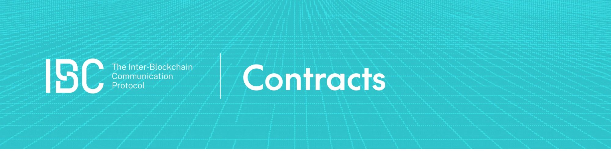

# IBC Contracts

[](https://github.com/cosmos/ibc-contracts/actions)
[](https://github.com/cosmos/ibc-contracts/actions)
[](https://github.com/cosmos/ibc-contracts/actions/workflows/codeql.yml)
[](https://scorecard.dev/viewer/?uri=github.com/cosmos/ibc-contracts)
[](https://www.apache.org/licenses/LICENSE-2.0)
[](https://discord.com/invite/interchain)
[](https://codecov.io/gh/cosmos/ibc-contracts)
[](https://getfoundry.sh/)
[](https://github.com/cosmos/ibc-contracts/releases)
[](https://github.com/cosmos/ibc-contracts/releases)
[](https://github.com/cosmos/ibc-contracts/releases)
[](https://github.com/cosmos/ibc-contracts/releases)



## Synopsis

This repository is the home of IBC contracts for Ethereum and Solana. The files include the Solidity contracts, the Solana programs, and the light clients.

The [Inter-Blockchain Communication (IBC) Protocol](https://github.com/cosmos/ibc) is the open standard for secure interoperability between independent systems. Visit the [IBC docs](https://ibcprotocol.dev/docs) for more information.

Contributions are welcome. See [CONTRIBUTING.md](CONTRIBUTING.md) for contribution guidelines.

## Repository layout

| Path | What it is |
| ---- | ---------- |
| [`ibc-solidity/contracts/`](ibc-solidity/contracts/README.md) | IBC core, applications, and light clients for EVM chains. |
| [`ibc-solidity/programs/`](ibc-solidity/programs/) | The Rust programs maintained alongside the contracts: the SP1 programs, the CosmWasm Ethereum light client, and the SP1 fixture operator. |
| [`ibc-solana/`](ibc-solana/README.md) | IBC core, applications, and light clients implemented as Anchor programs, with shared crates and integration tests. |
| [`programs/proof-api/`](programs/proof-api/) | Serves the proofs a relayer submits. |
| [`packages/`](packages/) | Shared Rust crates, including `go-abigen/` for the Go bindings. |
| [`e2e/`](e2e/) | End-to-end tests, powered by [interchaintest](https://github.com/strangelove-ventures/interchaintest). |
| [`docs/`](docs/) | Architecture decision records and [audit reports](docs/audits). |
| [`scripts/`](scripts/), [`tools/`](tools/) | Repository-wide scripts and test tooling. |

## Documentation

The published documentation for this repository lives at [ibcprotocol.dev](https://ibcprotocol.dev/docs/ibc/06-ibc-solidity-contracts/01-overview), and its source lives in [cosmos/ibc](https://github.com/cosmos/ibc/tree/main/docs). Documentation changes are tracked there.

- [IBC Solidity contracts](https://ibcprotocol.dev/docs/ibc/06-ibc-solidity-contracts/01-overview) is the reference for each contract: what it does, its storage, events, and roles.
- [Permissions and upgrades](https://ibcprotocol.dev/docs/ibc/06-ibc-solidity-contracts/06-permissions-and-upgrades) covers the roles, the proxies, and what each deployment fixes for good.
- [Solana programs](ibc-solana/README.md) covers deployment, key generation, access control, and upgradability.
- [`UPGRADEABILITY.md`](UPGRADEABILITY.md) is the procedure for upgrading a deployed contract.
- [Benchmarks](ibc-solidity/benchmarks/README.md) covers SP1 Tendermint packet costs and Besu QBFT light-client operation costs.

## Releases

See [`RELEASES.md`](RELEASES.md) for the versioning scheme, how to cut a release, and how to verify its signed files and image. Current versions are on the [releases page](https://github.com/cosmos/ibc-contracts/releases).

### Solidity contracts

| Contract | What it does | Released |
| -------- | ------------ | :------: |
| `ICS26Router.sol` | Sequencing, replay protection, and timeout checks. Passes proofs to light clients and resolves `portId` for app callbacks. Holds the provable IBC store. | ✅ |
| `ICS20Transfer.sol` | Sends and receives tokens against another ICS-20 implementation. | ✅ |
| `ICS27GMP.sol` | General message passing, through per-sender interchain accounts. | ✅ |
| `SP1ICS07Tendermint.sol` | Tendermint light client powered by SP1. The entry point for SP1 proofs. | ✅ |
| `AttestationLightClient.sol` | Verifies state attestations signed by a quorum of attestors. | ✅ |
| `utils/IFTBaseUpgradeable.sol` | Interchain Fungible Tokens using mint and burn semantics. | ✅ |
| `BesuLightClient.sol` | Besu IBFT 2.0 and QBFT light client. | ✅ |

### SP1 programs

| Program | What it does | Released |
| ------- | ------------ | :------: |
| `update-client` | Adds a consensus state from an IBC header, running the CometBFT light client protocol. Also supports a partial misbehaviour check. | ✅ |
| `membership` | Verifies `verify_membership` and `verify_non_membership` against a consensus state the client already holds. | ✅ |
| `uc-and-membership` | Updates the client and proves membership against the new consensus state, in one program. | ✅ |
| `misbehaviour` | Handles the case where a malicious subset of validators exceeds the client's trust level. | ✅ |

### Solana programs

No Solana release line is tagged yet. The programs below are on `main`.

| Program | What it does |
| ------- | ------------ |
| `ics26-router` | The router, matching the Solidity contract's responsibilities. |
| `ics27-gmp` | General message passing, through interchain accounts. |
| `ics07-tendermint` | Tendermint light client, powered by `tendermint-rs`. |
| `attestation` | The multisig light client. |
| `access-manager` | Stores the permissions for the whole system. |
| `ift` | Interchain Fungible Token. |

## Build

### Ethereum

Install [Rust](https://rustup.rs/), [Foundry](https://getfoundry.sh/introduction/installation), [Bun](https://bun.sh/), [Just](https://just.systems/man/en/), [SP1](https://docs.succinct.xyz/docs/sp1/getting-started/install), and the [Protobuf compiler](https://grpc.io/docs/protoc-installation/).

> [!NOTE]
> A Homebrew installation of Rust can fail the SP1 step. Install Rust through rustup instead.

Foundry usually manages contract dependencies with git submodules. This repository uses Node.js packages through Bun, because submodules do not scale:

```sh
cd ibc-solidity && bun install
```

Some end-to-end tests need the operator and proof API binaries:

```sh
just solidity::install-operator
just install-proof-api
```

> [!TIP]
> Nix users get every dependency with `nix develop`.

### Solana

Install [Rust](https://rustup.rs/), [Anchor](https://www.anchor-lang.com/docs/installation), [Agave](https://www.anchor-lang.com/docs/installation), and [Just](https://just.systems/man/en/). `ibc-solana/rust-toolchain.toml` selects the Rust version.

```sh
just solana::build-solana-programs
just solana::test-solana
```

List every Solana recipe with `just solana`.

> [!TIP]
> Nix users can run `nix develop .#solana`, then use `anchor-nix` in place of `anchor` from `ibc-solana/`.

### Deploy to an EVM chain

The Solidity contracts compile for the **Cancun** EVM and use EIP-1153 transient storage at runtime, in `ReentrancyGuardTransient` and in the proof caches of the SP1 Tendermint and Besu light clients. Deploy them only to a chain with Cancun enabled. On a pre-Cancun chain, packet handling and proof verification revert with an invalid opcode.

See the [contracts README](ibc-solidity/contracts/README.md) and the [Besu light client README](ibc-solidity/contracts/light-clients/besu/README.md#destination-evm-requirements).

## Test

### Unit tests

Solidity tests live in `ibc-solidity/test/` and are written with [forge](https://book.getfoundry.sh/forge/writing-tests):

```sh
just solidity::test-foundry
```

Pass a test name to run one of them:

```sh
just solidity::test-foundry test_success_sendTransfer
```

### Coverage

Coverage is reported to [Codecov](https://codecov.io/gh/cosmos/ibc-contracts) from the Foundry and Rust unit tests, tracked per component:

| Component | Path | Coverage |
| --------- | ---- | -------- |
| Solidity contracts | `ibc-solidity/contracts/` | [](https://app.codecov.io/gh/cosmos/ibc-contracts/components) |
| CosmWasm Ethereum light client | `ibc-solidity/programs/cw-ics08-wasm-eth/` | [](https://app.codecov.io/gh/cosmos/ibc-contracts/components) |
| Ethereum light client | `packages/ethereum/` | [](https://app.codecov.io/gh/cosmos/ibc-contracts/components) |
| Tendermint light client | `packages/tendermint-light-client/` | [](https://app.codecov.io/gh/cosmos/ibc-contracts/components) |

[`codecov.yml`](codecov.yml) has the full list.

### End-to-end tests

The tests in `e2e/interchaintestv8` are written in Go and use [interchaintest](https://github.com/strangelove-ventures/interchaintest). They spin up a local Ethereum network and a Tendermint network. Some generate proofs through the prover network, which needs an SP1 network private key in `.env`.

Install [Go](https://go.dev/doc/install), [Docker](https://docs.docker.com/get-docker/), and [Kurtosis](https://docs.kurtosis.com/install/). Kurtosis must match the `github.com/kurtosis-tech/kurtosis/api/golang` version in the e2e [`go.mod`](e2e/interchaintestv8/go.mod).

Then set up `.env` as [`.env.example`](.env.example) describes. After changing a contract interface or type, regenerate the ABIs with `just solidity::generate-abi`.

> [!NOTE]
> On a Mac with an M chip: set up Rosetta, enable it for Docker under Settings → General, and pull the Foundry image with `docker pull --platform=linux/amd64 ghcr.io/foundry-rs/foundry:latest`.

Five suites are available, each taking a test name:

| Suite | Command | Needs |
| ----- | ------- | ----- |
| IBC contracts through the proof API | `just test-e2e-eureka $TEST_NAME` | operator, proof API |
| The proof API itself | `just test-e2e-proof-api $TEST_NAME` | operator, proof API |
| Cosmos-to-Cosmos connections | `just test-e2e-cosmos-proof-api $TEST_NAME` | operator, proof API |
| SP1 ICS-07 Tendermint light client | `just test-e2e-sp1-ics07 $TEST_NAME` | operator |
| Multichain transfers | `just test-e2e-multichain $TEST_NAME` | operator, proof API |

### Lint

Development also uses [Natlint](https://docs.rs/crate/natlint/latest), [Abigen](https://geth.ethereum.org/docs/tools/abigen), [golangci-lint](https://golangci-lint.run/welcome/install/#local-installation), [jq](https://jqlang.org/), and [GNU Parallel](https://www.gnu.org/software/parallel/). Lint before committing:

```sh
just lint
```

## Security Assumptions

IBC is a peer-to-peer, light-client-based interoperability protocol. This repository contains the following light clients:

- **SP1 Tendermint Light Client** – Verifies the consensus state of a Cosmos SDK chain powered by SP1 and `tendermint-rs`. (Solidity)
- **Besu IBFT 2.0 / QBFT Light Client** – Verifies Besu BFT headers in header-validator mode, tracks the counterparty chain state root, and verifies EVM account/storage proofs for Eureka commitments. (Solidity)
- [**Ethereum Light Client**](./ibc-solidity/programs/cw-ics08-wasm-eth/README.md) – Verifies the consensus state of the Ethereum chain. (CosmWasm)
- **Attestation Light Client** – A multisig that can be used if the counterparty chain does not have a light client protocol. (Solidity and Solana)
- **Solana Tendermint Light Client** – Verifies the consensus state of a Cosmos SDK chain powered by `tendermint-rs`. (Solana)

The security of an IBC connection depends on the integrity of its light clients and their underlying trust assumptions, including the relevant validator or attestor sets.

Depending on the implementation, a light client can become **frozen** after detecting misbehaviour, such as two conflicting valid headers. A client with a trusting period can instead **expire** if it is not updated before that period elapses. Freezing and expiration are distinct conditions; recovery procedures depend on the client implementation.

### Handling Frozen Light Clients

When a light client freezes, Cosmos SDK chains rely on **governance** to restart the client. However, Ethereum and Solana lack a native governance mechanism for this purpose. **To address this, the Solidity and Solana implementations of IBC require a timelocked Security Council to restart the light client in case of a freeze.**

Additionally, the Security Council is responsible for:

- **Upgrading IBC contracts** in the event of a security vulnerability.
- **Introducing new features** while balancing security and decentralization.

Ideally, the Security Council should mirror the validators of the counterparty Cosmos SDK chain for better decentralization. In the future, a mechanism called **`govAdmin`** will allow the Cosmos SDK chain’s governance to directly control Ethereum contract upgrades via IBC (tracked in [#278](https://github.com/cosmos/ibc-contracts/issues/278)).

### Security Council and Governance Admin

Although **`govAdmin`** is not yet implemented, the contract tracking both admins is [`AccessManager`](https://github.com/OpenZeppelin/openzeppelin-contracts/blob/v5.3.0/contracts/access/manager/AccessManager.sol). We require that both admins are granted the admin role on `AccessManager.sol`:

- **`timelockedAdmin`** (Security Council)
- **`govAdmin`** (Governance Admin)

Other IBC contracts that require access control or upgradability should reference [`AccessManager`](https://github.com/OpenZeppelin/openzeppelin-contracts/blob/v5.3.0/contracts/access/manager/AccessManager.sol).

#### Admin Powers and Restrictions

Until **`govAdmin`** is implemented, the **Security Council** remains the sole administrator. Under the `AccessManager` contract, all admins have **equal authority**, including the ability to:

- Assign or modify the other admin.
- Manage roles on IBC contracts.
- Upgrade IBC contracts. Learn more about [upgrading the Solidity contracts](./UPGRADEABILITY.md).

#### Key Distinction Between Admins

The Security Council must enforce its own timelock. After delegation, `govAdmin` is intended to handle routine administration, while the Security Council intervenes when a light client is frozen. Both retain equal administrative permissions under `AccessManager`.

> [!WARNING]
>
> - The timelock on the **Security Council** is **not** enforced within the IBC contracts but should be self-enforced.
> - The timelock duration should be at least as long as:
>   - The **`govAdmin`** timelock (if applicable).
>   - The time required for governance proposals to pass.

### Roles and Permissions

The IBC Solidity contracts use [`AccessManager`](https://github.com/OpenZeppelin/openzeppelin-contracts/blob/v5.3.0/contracts/access/manager/AccessManager.sol) to manage roles and permissions and allow the admins to reassign roles. All the roles are defined in [`IBCRolesLib.sol`](./ibc-solidity/contracts/utils/IBCRolesLib.sol):

| **Role Name** | **Role Id** | **Description** |
|:---:|:---:|:---:|
| `ADMIN_ROLE` | 0 | Can grant and set target functions for all roles. |
| `RELAYER_ROLE` | 1 | Whitelisted relayer addresses. |
| `PAUSER_ROLE` | 2 | Can pause the IBC application contracts and app and client registration in the router. |
| `UNPAUSER_ROLE` | 3 | Can unpause the IBC application contracts and app and client registration in the router. |
| `DELEGATE_SENDER_ROLE` | 4 | Has permission to call `sendTransferWithSender`. |
| `RATE_LIMITER_ROLE` | 5 | Can set withdrawal rate limits per `ERC20` token. |
| `ID_CUSTOMIZER_ROLE` | 6 | Can set custom client and port ids for applications. |
| `ERC20_CUSTOMIZER_ROLE` | 7 | Can set custom `ERC20` contracts for non-native tokens instead of the default `IBCERC20`. |
| `PUBLIC_ROLE` | `type(uint64).max` | A role that everyone has by default. |

## License

Apache License, Version 2.0. See [LICENSE.md](LICENSE.md).

## Acknowledgements

Bootstrapped from this [Foundry template](https://github.com/PaulRBerg/foundry-template). The IBC implementations in [Solidity](https://github.com/hyperledger-labs/yui-ibc-solidity/), [CosmWasm](https://github.com/srdtrk/cw-ibc-lite), [Go](https://github.com/cosmos/ibc-go), and [Rust](https://github.com/cosmos/ibc-rs) were used as references. The `08-wasm` Ethereum light client from [unionlabs](https://github.com/unionlabs/union/) is the basis for this repository's own.