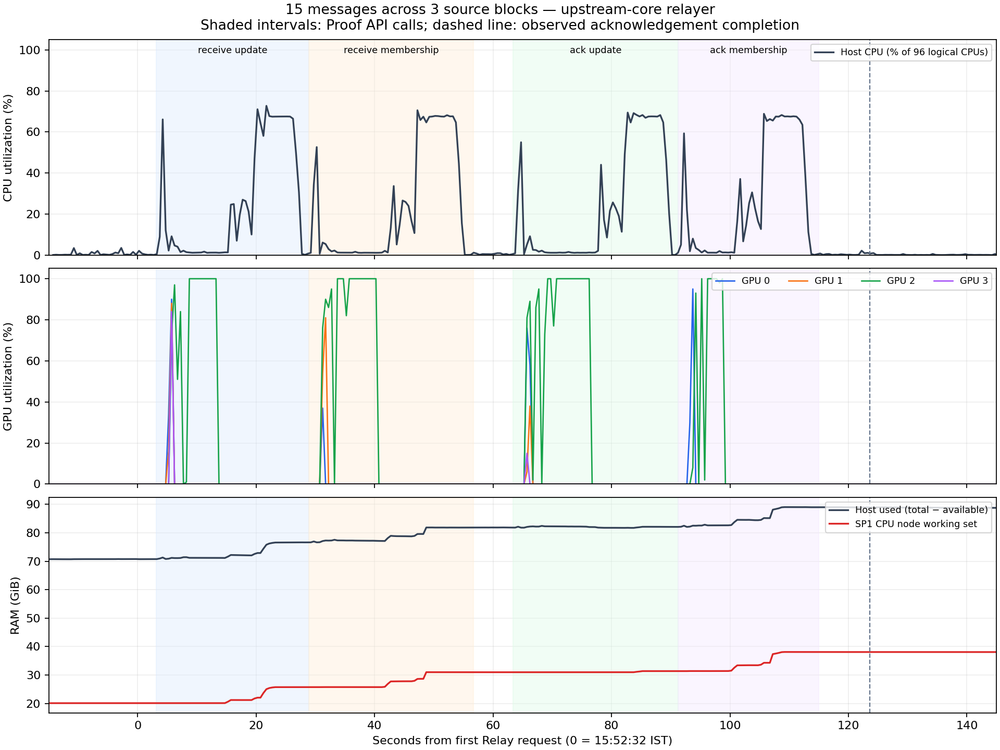

# Besu light client benchmark report

The report presents benchmark runs conducted on a dedicated GPU VM for this Besu ZK circuit. Results are based on recorded measurements, per-run summaries, proof-service logs, transaction receipts, and timestamped resource logs.

## Main results

- The successful 40-message burst had the highest destination delivery rate among the four main batch comparisons: 0.4595 messages/s, with all 40 delivered by 87.050 seconds. Final acknowledgements completed at 193.471 seconds: 0.2067 completed messages/s.
- The successful 80-message burst delivered at 0.3937 messages/s by polling observations, or approximately 0.4047 by mined block timestamps. Its full acknowledgement throughput was 0.1773 messages/s.
- The 64-message deadline run delivered all packets, but only 14/64 completed acknowledgements within 1,802.002 seconds. This is a partial result, not a successful 64-message round trip.
- CPU use was bursty, with low averages and occasional near-total host utilization. GPU work was uneven; GPU 2 carried most sampled activity in the successful 15-, 30-, and 80-message captures. These bursts do not establish maximum sustained capacity.
- Successful 40-message resource figures are estimates transferred from an earlier unsuccessful attempt. They are not measurements of the successful run.

## Measurement definitions

Delivery throughput = distinct messages / elapsed time from Relay submission until the last destination receipt was observed. It excludes acknowledgement processing. It measures destination delivery rather than source-chain injection or HTTP acceptance.

Completed throughput = acknowledged messages / full relay observation window. This window includes delivery and return acknowledgement. For a deadline run, only the completed subset belongs in the numerator.

Source preparation precedes the relay window. It includes source transactions and receipt collection. End-to-end workflow throughput including preparation uses preparation + relay duration.

Proof API time is the elapsed successful StateProof or PacketProofs call duration. It can include queueing, RPC/witness work, batching, proving, retrieval and validation. It is not isolated circuit execution time. Summed or averaged API durations are not interchangeable with wall-clock latency; calls can overlap, and failed calls/retry delays are omitted from successful-call timings.

API requests/s, proof jobs/s, messages/s, and on-chain transactions/s measure different work. Mined block timestamps have second-level precision; polling adds observation delay. Approximate mined rates also depend on an inferred relay-start anchor. Main batch comparisons consistently use polling observations.

## Environment

```text
+---------------------------------+----------------------------------------------------------------+
| Item                            | Configuration / measurement                                    |
+---------------------------------+----------------------------------------------------------------+
| Host CPU                        | 96 logical CPUs; host CPU % normalized across all 96           |
| Host usable RAM                 | 373.707 GiB              |
| GPUs                            | 4 NVIDIA A10G; 23028 MiB (~22.49 GiB) VRAM each        |
| Resource cadence                | Nominal 500 ms; sampled peaks may miss shorter bursts          |
| Proving services                | One CPU worker and four GPU workers in recorded batch captures |
| Historical membership maximum   | 32 entries per proof job; relayer groups could be larger       |
| Historical vanilla RPC deadline | 60 s per proof call            |
+---------------------------------+----------------------------------------------------------------+
```

Resource captures report approximately 373.7 GiB of usable host RAM. The settings above describe the benchmark environment at the time of testing.

## Proof baseline - pre-batch-optimizations

The baseline used a four-validator source chain and a one-validator destination chain, with one message per proof path. The table contains three recorded measurements and their arithmetic means. Exact execution dates and corresponding raw logs are unavailable for these runs.

```text
+---------------------------+-----------+-----------+-----------+----------+
| Proof / total             | Run 1 (s) | Run 2 (s) | Run 3 (s) | Mean (s) |
+---------------------------+-----------+-----------+-----------+----------+
| 4-validator update client | 116.168   | 114.184   | 85.907    | 105.420  |
| Packet membership         | 91.921    | 86.000    | 79.865    | 85.929   |
| Forward proof total       | 208.089   | 200.184   | 165.772   | 191.348  |
| 1-validator update client | 93.958    | 81.949    | 85.999    | 87.302   |
| ACK membership            | 75.836    | 97.913    | 77.909    | 83.886   |
| ACK proof total           | 169.794   | 179.862   | 163.908   | 171.188  |
| All four proofs           | 377.883   | 380.046   | 329.680   | 362.536  |
+---------------------------+-----------+-----------+-----------+----------+
```
These are calculations from proof times, not observed delivery TPS.


### Recorded run inventory


```text
+-----+------------------------------+------+------+----------+---------+--------------------+
| ID  | Test                         | Load | Done | Wall s   | Rate /s | Outcome            |
+-----+------------------------------+------+------+----------+---------+--------------------+
| R01 | latest-height                | 8    | 8    | 0.367    | 21.7980 | PASS               |
| R02 | packet-proofs                | 1    | 1    | 26.809   | 0.0370  | PASS               |
| R03 | packet-proofs                | 10   | 10   | 99.571   | 0.1000  | PASS               |
| R04 | end-to-end relayer           | 10   | 10   | 133.196  | 0.0751  | PASS               |
| R05 | end-to-end relayer           | 15   | 15   | 123.602  | 0.1214  | PASS               |
| R06 | single-message end-to-end    | 1    | 1    | 128.258  | 0.0078  | PASS               |
| R07 | end-to-end relayer           | 3    | 3    | 125.415  | 0.0239  | PASS               |
| R08 | end-to-end relayer           | 64   | 0    | N/A      | N/A     | INCOMPLETE RECORD  |
| R09 | end-to-end relayer           | 64   | 14   | 1802.002 | 0.0078  | DEADLINE / PARTIAL |
| R10 | end-to-end relayer           | 30   | 0    | N/A      | N/A     | INCOMPLETE RECORD  |
| R11 | end-to-end relayer           | 30   | 30   | 352.165  | 0.0852  | PASS               |
| R12 | end-to-end relayer           | 40   | 0    | N/A      | N/A     | INCOMPLETE RECORD  |
| R13 | end-to-end relayer           | 40   | 40   | 193.471  | 0.2067  | PASS               |
| R14 | end-to-end relayer           | 80   | 56   | N/A      | N/A     | INCOMPLETE RECORD  |
| R15 | end-to-end relayer           | 80   | 0    | N/A      | N/A     | INCOMPLETE RECORD  |
| R16 | end-to-end relayer           | 80   | 80   | 451.095  | 0.1773  | PASS               |
| R17 | historical revert diagnostic | -    | -    | N/A      | N/A     | REVERT REPRODUCED  |
+-----+------------------------------+------+------+----------+---------+--------------------+
```


## Main batch comparison: delivery, acknowledgement and proving - post optimizations

These are the four fully successful 15-, 30-, 40- and 80-message runs. Proof columns describe successful receive-side API calls only. The 30- and 80-message values average two successful receive sequences; the others contain one sequence. The following test runs were performed after the ZK circuit was further optimized to enable proof generation in batch mode.

```text
+-----+------+------------+-------------+------------+--------+----------+--------------+------------+
| ID  | Msgs | Delivery s | Msgs/s      | Full ACK s | ACK /s | Update s | Membership s | Combined s |
+-----+------+------------+-------------+------------+--------+----------+--------------+------------+
| R05 | 15   | 60.865     | 0.2464      | 123.602    | 0.1214 | 25.820   | 27.803       | 53.623     |
| R11 | 30   | 242.130    | 0.1239      | 352.165    | 0.0852 | 36.527   | 46.601       | 83.128     |
| R13 | 40   | 87.050     | 0.4595      | 193.471    | 0.2067 | 23.842   | 51.668       | 75.510     |
| R16 | 80   | 203.176    | 0.3937      | 451.095    | 0.1773 | 57.068   | 104.394      | 161.462    |
+-----+------+------------+-------------+------------+--------+----------+--------------+------------+
```

```text
+------+-------------------------+---------------------+----------------+
| Msgs | Approx mined delivery s | Approx mined msgs/s | Polling msgs/s |
+------+-------------------------+---------------------+----------------+
| 15   | 58.870                  | 0.2548              | 0.2464         |
| 30   | 238.660                 | 0.1257              | 0.1239         |
| 40   | 82.865                  | 0.4827              | 0.4595         |
| 80   | 197.686                 | 0.4047              | 0.3937         |
+------+-------------------------+---------------------+----------------+
```

The 80-message run achieved approximately 0.4047 messages/s using mined timestamps and 0.3937 messages/s using polling observations. The corresponding 30-message rates were 0.1257 and 0.1239 messages/s. Comparisons in this report use polling observations consistently; mined-time rates are shown separately because they use a different timing boundary.

```text
+-----+----------------------+--------------------+---------+--------+----------------------------+----------------------------------------------+
| ID  | Source preparation s | ACK rate incl prep | Recv tx | ACK tx | Receive membership entries | ACK membership entries                       |
+-----+----------------------+--------------------+---------+--------+----------------------------+----------------------------------------------+
| R05 | 11.266               | 0.1112             | 1       | 1      | {"15": 1}                  | {"15": 1}                                    |
| R11 | 15.579               | 0.0816             | 2       | 2      | {"20": 1, "10": 1}         | {"20": 1, "10": 1}                           |
| R13 | 28.557               | 0.1802             | 1       | 2      | {"32": 1, "8": 1}          | {"8": 1, "32": 1}                            |
| R16 | 36.501               | 0.1641             | 2       | 5      | {"32": 2, "8": 2}          | {"24": 1, "16": 1, "3": 1, "25": 1, "12": 1} |
+-----+----------------------+--------------------+---------+--------+----------------------------+----------------------------------------------+
```

Source blocks, relayer transaction groups and membership proof jobs have different boundaries. In the 40-message successful run, four source blocks became one receive transaction containing proofs for 32+8 entries. The 80-message receive path used two transactions of 40 messages each, with 32+8 entries per transaction. Histograms above count verified membership events; they do not count update proofs.


## Resource utilization observed

CPU columns are host percentages. GPU columns are average/peak utilization percentages. These windows include receive and ACK processing, while delivery throughput above ends earlier. R05 and R07 use preserved time-weighted analyses; R06 covers only the captured part of the relay window. R11 uses sample means; R16 uses the preserved sample analysis ending at the final ACK block. R09 alignment is approximate.



The chart shows CPU, GPU and RAM use during the 15-message run (R05). Shaded areas mark proof API calls, and the dashed line marks acknowledgement completion. GPU 2 handled most of the GPU work.

```text
+-----+------+---------------+------------+-----------+---------------+---------------+---------------+---------------+
| ID  | Msgs | Basis         | CPU peak % | CPU avg % | GPU0 avg/peak | GPU1 avg/peak | GPU2 avg/peak | GPU3 avg/peak |
+-----+------+---------------+------------+-----------+---------------+---------------+---------------+---------------+
| R05 | 15   | Measured      | 72.75      | 21.11     | 1.70/95       | 1.14/88       | 23.22/100     | 0.40/84       |
| R06 | 1    | Measured      | 71.05      | 20.62     | 1.48/97       | 0.96/95       | 21.45/100     | 0.48/95       |
| R07 | 3    | Measured      | 100.00     | 26.03     | 1.52/94       | 0.81/76       | 20.25/100     | 0.02/3        |
| R09 | 64   | Approx window | 99.58      | 31.58     | 34.78/100     | 2.02/100      | 2.31/97       | 6.95/100      |
| R11 | 30   | Measured      | 95.90      | 25.07     | 4.23/100      | 1.22/96       | 22.98/100     | 2.20/97       |
| R13 | 40   | ESTIMATE      | ~75        | ~22       | ~2.7/~96      | ~0.7/~90      | ~27.9/~100    | ~0.9/~96      |
| R16 | 80   | Measured      | 74.31      | 24.47     | 1.59/96       | 1.90/96       | 31.58/100     | 0.78/96       |
+-----+------+---------------+------------+-----------+---------------+---------------+---------------+---------------+
```


```text
+-----+------------------+-------------------+---------------+---------------+---------------+---------------+
| ID  | Host RAM avg | Host RAM peak GiB | GPU0 peak GiB | GPU1 peak GiB | GPU2 peak GiB | GPU3 peak GiB |
+-----+------------------+-------------------+---------------+---------------+---------------+---------------+
| R05 | 80.31            | 89.04             | 10.41         | 10.22         | 11.23         | 10.32         |
| R06 | 79.46            | 86.00             | 10.41         | 10.22         | 11.23         | 10.35         |
| R07 | 81.70            | 90.47             | 10.41         | 10.22         | 11.23         | 10.35         |
| R09 | 92.50            | 101.69            | 11.73         | 11.19         | 11.23         | 11.26         |
| R11 | 85.76            | 95.16             | 11.16         | 10.26         | 11.23         | 10.19         |
| R16 | 84.89            | 91.71             | 15.35         | 15.28         | 14.63         | 10.22         |
+-----+------------------+-------------------+---------------+---------------+---------------+---------------+
```

GPU memory columns measure allocated VRAM, not compute utilization or memory-bandwidth utilization. Captured usable capacity is approximately 22.49 GiB per GPU.

## All resource-capture windows

The following tables cover the 11 recorded resource-capture sequences from `~/metrics`, including interrupted attempts. Statistics are arithmetic sample means and maxima over each entire capture, including idle periods and retries. These capture windows differ from the matched relay windows above and are reported separately. Capture dates are IST; sequence IDs identify resource captures, not benchmark runs.

```text
+-----+----------------------------------------------------------+----------------+--------------+-----------+------------+--------------+
| Seq | Mapping                                                  | End IST        | Host samples | CPU avg % | CPU peak % | RAM peak GiB |
+-----+----------------------------------------------------------+----------------+--------------+-----------+------------+--------------+
| 1   | Historical single-message capture; exact run not matched | 10-07 19:44:08 | 341          | 15.54     | 73.68      | 89.58        |
| 2   | R05                                                      | 10-12 15:56:12 | 472          | 11.23     | 72.75      | 89.04        |
| 3   | R06; starts late                                         | 10-12 18:39:48 | 300          | 17.02     | 71.05      | 86.00        |
| 4   | R07                                                      | 10-12 19:01:39 | 314          | 20.96     | 100.00     | 90.47        |
| 5   | R08; partial attempt                                     | 10-13 13:55:32 | 1208         | 5.95      | 92.91      | 9.66         |
| 6   | R09; capture extends beyond run                          | 10-13 15:51:33 | 9509         | 14.55     | 99.58      | 101.69       |
| 7   | R10; very short capture                                  | 10-13 18:08:53 | 49           | 0.75      | 2.60       | 75.50        |
| 8   | R11                                                      | 10-13 18:20:35 | 766          | 23.15     | 95.90      | 95.16        |
| 9   | R12; also proxy source for R13 estimate                  | 10-13 19:23:33 | 2872         | 34.93     | 97.58      | 99.34        |
| 10  | R15                                                      | 10-14 13:48:00 | 148          | 1.23      | 3.21       | 69.66        |
| 11  | R16                                                      | 10-14 13:58:14 | 1019         | 21.81     | 74.31      | 91.71        |
+-----+----------------------------------------------------------+----------------+--------------+-----------+------------+--------------+
```

```text
+----------+-----------------+-----------------+-----------------+-----------------+
| Sequence | GPU0 avg/peak % | GPU1 avg/peak % | GPU2 avg/peak % | GPU3 avg/peak % |
+----------+-----------------+-----------------+-----------------+-----------------+
| 1        | 33.32/100       | 0.24/82         | 1.72/97         | 0.95/96         |
| 2        | 0.89/95         | 0.60/88         | 12.16/100       | 0.21/84         |
| 3        | 1.37/97         | 0.79/95         | 17.71/100       | 0.43/95         |
| 4        | 1.21/94         | 0.65/76         | 16.17/100       | 0.02/3          |
| 5        | 0.00/0          | 0.00/0          | 0.00/0          | 0.00/0          |
| 6        | 15.71/100       | 0.87/100        | 1.00/97         | 3.45/100        |
| 7        | 0.00/0          | 0.00/0          | 0.00/0          | 0.00/0          |
| 8        | 3.89/100        | 1.12/96         | 21.12/100       | 2.02/97         |
| 9        | 7.21/100        | 3.51/100        | 39.22/100       | 2.57/97         |
| 10       | 0.00/0          | 0.00/0          | 0.00/0          | 0.00/0          |
| 11       | 1.41/96         | 1.68/96         | 27.96/100       | 0.69/96         |
+----------+-----------------+-----------------+-----------------+-----------------+
```


## Interpretation and limits

1. Batching reduced the proof overhead per message. The 15-message run and the single-message run took about the same total relay time. Larger batches may still take longer to prove.
2. Sending more messages did not always improve throughput. Retries, scheduling and batch grouping also differed, so batch size alone does not explain the difference.
3. CPU use rose in bursts, and GPU work was uneven. CPU limits, the order of proof stages and API scheduling may have added delays. The samples do not show how much each contributed or whether CPU limits slowed the work.
4. Each batch size has only one successful comparison run. Repeated tests and longer runs under sustained load are needed to measure typical performance, variation and maximum throughput. The report contains no measured comparison of different concurrency settings.

