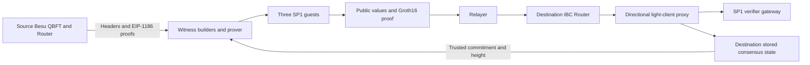

# Architecture

The Besu QBFT ZK light client authenticates a counterparty EVM consensus state and verifies the
Router storage needed for IBC packets, acknowledgements, and timeouts. It uses three independent
SP1 programs and an upgradeable Solidity light client. One deployment tracks one source chain
from one destination chain; bidirectional IBC uses a deployment in each direction.

This guide describes the implemented consensus and state-proof design, including batched
membership. Exact protocol encodings, requirements, and acceptance criteria are consolidated
in [SPEC.md](../SPEC.md). Membership uses schema 2 and FULL/CACHED envelopes; update and
non-membership retain schema 1.

Implementation status and deployment validation are tracked in
[Proof API implementation](PROOF_API_IMPLEMENTATION.MD).

## Components and trust boundary



RPC responses, the witness builder, the prover, and the relayer are not consensus authorities.
The guest proves its statement; Solidity verifies the operation-specific program proof and binds
its public values to local state and the Router's request. A valid state proof for a candidate source
root cannot be accepted until that root exists at the requested destination consensus height.

The bootstrap anchor and Router-governing AccessManager are explicit trust assumptions. The
AccessManager authorizes light-client upgrades and can therefore change the implementation's
behavior. See [Deployment](DEPLOYMENT.md) and [security assumptions](#security-assumptions-and-limitations).

| Component | Responsibility | Source |
| --- | --- | --- |
| Shared deterministic Rust | Types, QBFT, MPT, paths/slots, batches, ABI | `crates/` |
| Guest entry points | Read witness, verify through shared crates, commit ABI bytes | `programs/` |
| Proving tooling | RPC acquisition, normalization, witness building, execution/proving, artifacts | `tooling/prover-script/` |
| Scheduler library | Bounded membership admission, deduplication, batch sealing, result fan-out | `tooling/proof-api-integration/` |
| Unified Proof API | Relayer protocol, route validation, packet processing, scheduling, in-process proving | `tooling/proof-api/` |
| Light-client contract | Consensus storage, time policies, proof bindings, verified-batch cache | `contracts/src/BesuQBFTZKLightClient.sol` |
| Upstream Router | IBC message processing and client routing | external checkout used only by `e2e/solidity` |
| Relayer | Transaction submission, receipt tracking, retries and durable relay state | external service |

The guest/shared crates do not depend on RPC clients. CLI and HTTP tooling call the same shared
verification rather than maintaining a second host-only definition of proof validity.

## Trusted state and bootstrap

Initialization binds the local Router, source Router, SP1 gateway, three distinct VKeys, time
policies, and an initial counterparty consensus state. Solidity stores:

| State | Meaning |
| --- | --- |
| `latestHeight` | Highest accepted counterparty height |
| `consensusStates[H].stateRoot` | Authenticated global EVM state root |
| `consensusStates[H].blockTimestamp` | Authenticated timestamp of that same block |
| `consensusStates[H].validatorSetHash` | Commitment to its ordered QBFT validator addresses |
| `verifiedMembershipBatches[batchId]` | Membership batches accepted by this client instance |

Full validator arrays and MPT nodes are private witness data, not persistent Solidity state.
The initial anchor comes from one finalized source block through deployment/governance; it is not
established by an update proof from an earlier state.

An update is needed only when the required height is not already stored. Many IBC operations can
reuse one accepted consensus state. Membership cache reuse and consensus-state reuse are separate:
one shares a verified batch proof; the other shares an authenticated block root.

## Update-client proof

The witness supplies trusted height T, its validator-set commitment, the private trusted validator
array, and one newer target header H. No intermediate-header replay or validator-vote-history replay
is performed.

The guest:

1. Checks the schema, nonzero trusted height, canonical trusted validators, and their commitment.
2. Requires H > T and a nonzero target timestamp; checks supported contiguous header-tail fields.
3. Parses target QBFT extra data: vanity, validators, vote, round, and committed seals.
4. Reconstructs the complete canonical header RLP with **only the committed-seal list emptied**.
   The round stays in the signing preimage. Keccak of that RLP is the committed-seal digest.
5. Recovers each signer, rejects zero/non-validator/duplicate signers, and checks both thresholds:

   ```text
   target quorum = ceil(2 * target_validator_count / 3)
   trusted overlap = floor(trusted_validator_count / 3) + 1
   ```

6. Commits trusted height/hash and the authenticated target height, root, timestamp, and new
   validator-set commitment.

The validator commitment uses a domain string, big-endian u32 count, and strictly ascending raw
20-byte addresses. The guest rejects an unsorted list rather than repairing it.

A committed seal has valid nonzero secp256k1 scalars and recovery ID 0 or 1. The internal parser
produces immutable validated seals so update verification can reuse decoded signatures. Public
parsing/recovery APIs still check untrusted bytes. High-S signatures are accepted through equivalent
low-S recovery with flipped parity; public parsing preserves their original bytes.

Solidity binds the trusted commitment to stored state, enforces the trusting period, increasing
height/timestamp, and clock-drift policy, then verifies `UPDATE_CLIENT_VKEY`. It stores the target
consensus state, accepts an identical existing state as a no-op, and rejects a conflicting state.
Chain ID is an RPC endpoint sanity check, not cryptographic QBFT domain separation.

## State-proof foundation

Membership and non-membership authenticate the source Router account under an EVM state root R_H,
extract its storage root S_H, then authenticate an exact derived storage key under S_H.

Each supported Router path is a one-element `bytes[]` whose terminal bytes are:

```text
packet:          clientId || 0x01 || U64_BE(sequence)
receipt:         clientId || 0x02 || U64_BE(sequence)
acknowledgement: clientId || 0x03 || U64_BE(sequence)

pathDigest = keccak256(abi.encode(path))
K = keccak256(keccak256(terminalPath) || IBCSTORE_STORAGE_SLOT)
```

The slot preimage contains two 32-byte words. The namespace constant is defined in
[`constants.rs`](../crates/types/src/constants.rs) and checked against upstream storage-layout
vectors. Ethereum secure-trie keys hash the raw Router address for account lookup and the 32-byte
logical slot K for storage lookup. RPC-provided keys/values cannot replace guest derivation.

MPT verification checks canonical RLP, compact paths, child references, exact key traversal, and
proof-node use. Account decoding validates the complete account, even when only storageRoot is
returned. Storage comparison can avoid constructing a padded word, but still authenticates and
validates its canonical integer encoding.

## Batched membership

A schema-2 witness contains one height, state root, source Router, shared account proof, and 1–32
entries. Each entry contains an exact packet/ACK path, expected commitment, and storage proof.

Host tooling derives slots, requests multi-key `eth_getProof`, matches returned proofs by key,
and constructs canonical entry order. The guest independently:

- authenticates the shared Router account once;
- validates each packet/ACK path and derives its slot;
- requires strictly increasing path digests, rejecting duplicates;
- proves every expected 32-byte commitment under the shared storage root;
- commits the count and positional Merkle root of the validated entries.

The batch tree uses domain-separated Keccak hashes:

```text
leaf   = keccak256(0x00 || pathDigest || expectedCommitment)
parent = keccak256(0x01 || left || right)
padding leaf = keccak256(0x02)
```

Leaves are padded to the next power of two. Position matters; proofs are not sorted-pair Merkle
proofs. The expected commitment is already the Router's exact commitment and is not re-hashed as
an IBC value by the light client.

### FULL and CACHED submission

The Router still invokes `verifyMembership` for one item at a time. Each envelope carries the
batch root/count, leaf index, and positional Merkle branch.

| Mode | Payload | Contract behavior |
| --- | --- | --- |
| FULL (1) | Nonempty public values and proof bytes | Bind schema-2 values to stored state, Router, root/count; verify the membership SP1 proof; cache batch ID |
| CACHED (2) | Empty public values and proof bytes | Require the same computed batch ID already cached |

Both modes bind the current Router-supplied path and value to a leaf and verify its branch. The
cache key binds schema 2, height, stored state root, source Router, batch root, count, and membership
VKey. The cache belongs to one client instance. Cache pruning is not defined.

Typical relay order is an optional update for H, one FULL membership item, then CACHED items for
the same batch. Calls may span transactions. If submitted atomically and a later call reverts,
normal EVM transaction rollback also removes earlier cache writes from that transaction.

## Receipt non-membership and timeouts

The schema-1 non-membership guest accepts only receipt paths. It authenticates the existing Router
account and proves that the exact derived receipt key is absent. `Present(0)` is rejected just as
any other present value is rejected; a zero RPC storage value is not absence evidence.

Solidity binds height, stored root, source Router, path digest, and `NON_MEMBERSHIP_VKEY`, then
returns the timestamp from that same consensus state. The Router evaluates timeout timing using
that authenticated time. A timestamp from another height must not be substituted. Non-membership
has no membership-batch cache or FULL/CACHED mode.

## Encodings and program separation

| Program | Public schema | Public fields after schema version |
| --- | --- | --- |
| update-client | 1 | trusted height/hash; verified height; state root; timestamp; new validator hash |
| membership | 2 | proof height; state root; source Router; batch root; entry count |
| non-membership | 1 | proof height; state root; source Router; path digest |

Private witnesses use SP1 serde transport. Public values use Solidity ABI; headers/accounts/trie
nodes use RLP. Update and non-membership use `SP1ProofEnvelope`; membership uses
`MembershipBatchProofEnvelope`. Strict codecs reject unsupported schemas and noncanonical data.
The selected contract function chooses its VKey; a relayer cannot substitute another program's key.
Exact types live in [`crates/types`](../crates/types/src/lib.rs) and
[`BesuZKTypes.sol`](../contracts/src/BesuZKTypes.sol).

## Service integration

The unified Rust Proof API calls the shared proving service in process and uses the scheduler
library for cross-request membership batching. It resolves one configured client route, validates
artifact approvals against deployed VKeys, and checks chain snapshots around proving. The relayer
submits the returned envelopes; the API does not send transactions or persist jobs.

[Integration](INTEGRATION.md) documents protocol methods, response ordering, and the separate legacy
HTTP utility. Runtime defaults and configuration belong to the
[Proof API runtime guide](../tooling/proof-api/README.md).

## Build, deployment, and verification

Canonical guest ELFs, frozen release identities, the verifier route, and deployed VKeys form one
versioned deployment boundary. Guest changes can alter ELF hashes/VKeys without changing schemas.
Migration to batched membership also requires compatible contract code and envelopes, not just a
replacement VKey. Follow [Release](RELEASE.md) and [Deployment](DEPLOYMENT.md).

Native tests check deterministic behavior; SP1 execution checks guest behavior; real proofs and
live IBC tests check the integrated system. None substitutes for the others. The current performance
baseline remains pending until measured. See [Testing](TESTING.md) for the verification sequence.

## Security assumptions and limitations

The initial trusted anchor and Router-governing AccessManager are trusted inputs. RPC responses,
relayers, witness producers, public values, and proof envelopes are untrusted until the guests and
contract have checked their relevant bindings. Upgrades can change implementation-controlled state
and verification behavior; upgrade authority is therefore as important as the initial deployment.

Independent target quorum/trusted overlap, unique recovered signers, canonical validator commitments,
exact-key MPT exclusion, `Present(0) != Absent`, separate program VKeys, and FULL/CACHED item binding
are security invariants. Resource controls at service boundaries must not silently change protocol
validity by inventing new validator/path/proof limits. The membership cap of 32 is an explicit
protocol rule, not an infrastructure timeout setting.

Misbehaviour proofs and frozen-client semantics are not implemented; `misbehaviour` reverts.
Timeouts require absence and authenticated time from the same stored consensus height. A cached
batch proves only its bound items; it does not authenticate arbitrary Router storage.

Report suspected vulnerabilities privately to the project maintainers. Do not include keys,
private endpoints, or other secrets in public reports. A passing native suite is not a security
audit or proof-backed validation of a newly built release.

## IBC dependency compatibility

Standalone contracts use the versioned interfaces and message types under `contracts/vendor/ibc`.
A matching ABI alone does not establish compatibility: paths, commitment semantics, and the fixed
mapping slot are part of the proof statement. The separate E2E workspace checks these against an
external Router checkout; its setup and revision selection are documented in
[Testing](TESTING.md#optional-router-integration-workspace).

Standalone deployment and Router registration are separate operations. See
[Deployment](DEPLOYMENT.md) for their checks and prerequisites.
